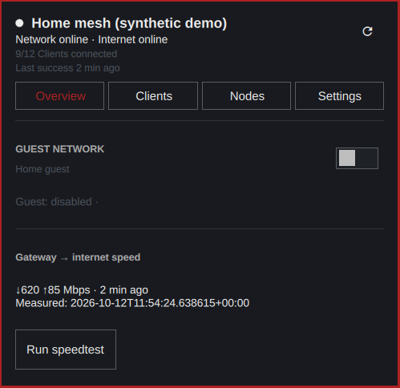
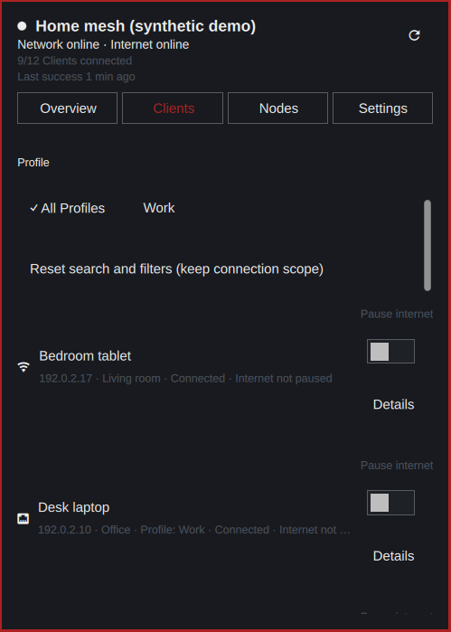

# eero-bar

An unofficial eero mesh-network monitor and control panel for the native Omarchy bar. Python 3 standard library only; no browser automation or additional Python packages.

[Русский](README.ru.md) · [Usage guide](docs/usage.md) · [Contributing](CONTRIBUTING.md) · [Security](SECURITY.md)


*Actual native UI with synthetic network data; not a live account or authentication demonstration.*


*Actual native UI with synthetic clients, names and identifiers.*

## Features

- Network health, last successful refresh, nodes, clients and profiles.
- Client search and filtering, node details, keyboard navigation and host theme integration.
- Guest Wi-Fi, node LEDs, client/profile pause, speed test and confirmed reboot requests.
- Separate eero email/phone OTP and Amazon browser sign-in flows.
- Host-persisted refresh interval, density and client-display preferences.

## Requirements and installation

Requires an Omarchy host with the current plugin service/bar-widget API and native `qs.Ui` / `qs.Commons` components, its Quickshell runtime, and Python 3. The documented host baseline is **Omarchy 4.0.4**, not a promise of compatibility with every newer or older release. Amazon sign-in also needs a working system default browser and direct access to local loopback pages.

**Omarchy plugins are unsandboxed. Read and trust the source before enabling it.** This plugin can store an account Session and send network-changing requests.

Install from GitHub, then place the widget in the right section of the bar:

```sh
omarchy plugin add https://github.com/Nombah501/eero-bar.git
omarchy plugin enable n501.eero-bar --section right
```

The repository root is the plugin root.

## First use

Click the eero bar icon. For an existing eero email/phone login, enter the identifier, choose **Send code**, then **Verify**. An Amazon email does not automatically support OTP.

For Amazon, choose **Sign in with Amazon**, complete password/MFA in the default browser, and paste the entire returned Amazon address into the masked local return page. It is a secret: do not put it in an issue or chat. Return to the panel and choose **Save new Session** only if you want to replace the saved Session. Cancelling before approval preserves an existing Session. See the [complete sign-in guide](docs/usage.md#sign-in).

## Settings

Open the panel's Settings page; preferences are saved by the Omarchy host.

| Setting | Default | Effect |
|---|---|---|
| `pollSeconds` | `60` | Refresh interval, 30–3600 seconds |
| `showClientCount` | `false` | Show connected/total clients beside the bar icon |
| `density` | `compact` | `compact` or `comfortable`; retains host theme/font |
| `showOfflineClients` | `false` | Include offline clients initially when opening the panel |

## Limits and safety

Uses the **unofficial mobile control API**, not the official read-only EU Data Act API. Upstream changes can break it. Only the first network in the account is selected; there is no network selector. Amazon currently uses the default US flow; other marketplaces, Session lifetime and token rotation are not promised.

Portable tests and synthetic native/browser checks are not proof of fresh human Amazon login/re-login or full live production acceptance. A request acknowledgement is not proof that a reboot completed or that a setting changed: check subsequent readback. Sign out deletes only the local Session, not a server-side authorization.

[Usage and troubleshooting](docs/usage.md) · [API notes](docs/eero-api.md) · [Service contract](docs/service-api.md) · [Helper contract](docs/helper-protocol.md)

## License

[MIT](LICENSE), by N501. Not affiliated with or endorsed by eero or Amazon.
